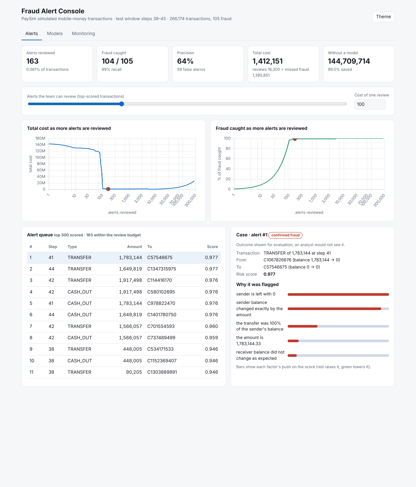
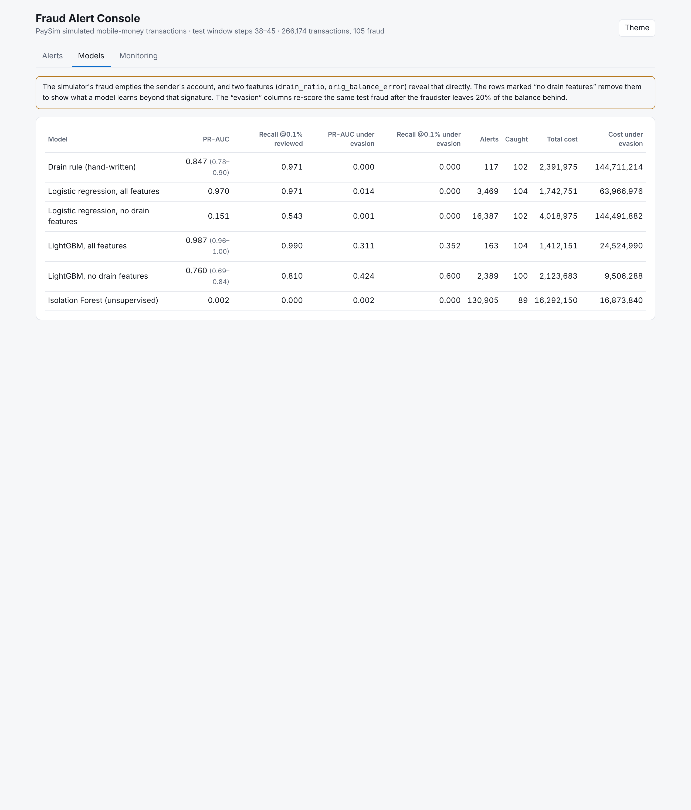
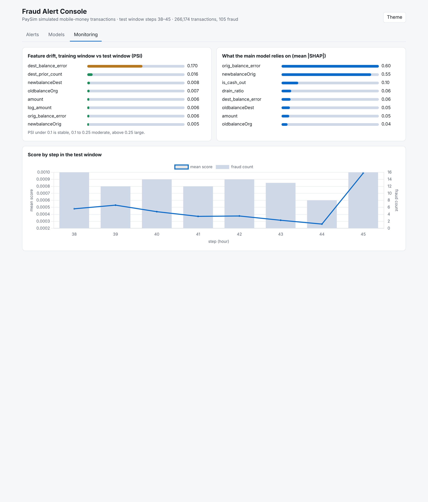

# Transaction Fraud Detection

A fraud-detection pipeline for mobile-money transactions: point-in-time features, a comparison of a
hand-written rule, linear, boosted-tree and unsupervised models, cost-based alert thresholds, SHAP
explanations, a scoring API, and a web console where an analyst works through the alert queue.



It is built on [PaySim](https://www.kaggle.com/datasets/ealaxi/paysim1), a public *simulation* of mobile-money
transactions. That matters for how to read every number below, so the data section comes first.

## The data, and what it limits

The file used is the Kaggle PaySim CSV (CC BY-SA 4.0; E. Lopez-Rojas, A. Elmir, S. Axelsson, *PaySim: A financial
mobile money simulator for fraud detection*, EMSS 2016). It is not stored in this repo; see [Run it](#run-it).
This copy contains **999,999 rows covering the first 45 hours (steps 1 to 45), with 535 frauds (0.054%)**.

Things found by profiling it, which shaped the design:

| Finding | Consequence |
|---|---|
| Fraud only occurs in `TRANSFER` and `CASH_OUT` | The other three types are never flagged |
| Sender accounts almost never repeat (999,758 distinct senders in 999,999 rows) | No per-customer history is possible, so "spending vs this customer's normal" features are not built. Account history is used on the **receiving** side instead |
| 95% of frauds move exactly the sender's whole balance; **0%** of ordinary transfers do | An obvious simulator signature. A one-line rule catches most fraud, so a model's score on this data says little without the controls below |
| The window is under two days | Time-of-day drift cannot be measured, so `hour` is excluded from the drift panel |

## Pipeline

```
 PaySim CSV ─► features (point-in-time) ─► time split ─► models ─► evaluation ─► console + API
                  │                          train  steps 1-30       │
                  │                          valid  steps 31-37      └► SHAP reasons ─► local-LLM case notes
                  └► same logic, one event at a time (serving)        test   steps 38-45 (used once)
```

- **Time split, never shuffled.** Train on the past, choose the alert threshold on the next window, report on the last.
- **Point-in-time features.** A feature of a transaction uses that transaction and *earlier* ones only (sender and
  receiver balances, how the balances change, receiver's prior transaction count and amount, first-seen receiver,
  transaction type). A test changes later rows and checks earlier features do not move.
- **Training/serving parity.** Features exist twice, vectorised for training and event-by-event for the API.
  A test asserts the two produce identical values on 3,000 transactions.
- **Metrics for rare events.** PR-AUC, recall and precision at a fixed review budget, and money. Accuracy is not
  reported: always predicting "legitimate" scores 99.95% here. A negative-control test confirms random scores
  look random.
- **Cost-based threshold.** Cost = value of fraud missed + review cost per alert (100 units, an assumption you can
  change in the console). The alert count is picked on the validation window and applied unchanged to the test window.

## Results

Test window (steps 38 to 45): 266,174 transactions, **105 frauds**. One run, fixed seeds. "Recall @0.1%" means the
team reviews only the 266 highest-scored transactions. Precision at that budget cannot exceed 105/266 = 39%.

| Model | PR-AUC (95% CI) | Recall @0.1% | PR-AUC after evasion | Recall @0.1% after evasion | Alerts at chosen threshold | Fraud caught | Total cost | Cost after evasion |
|---|---|---|---|---|---|---|---|---|
| Hand-written drain rule | 0.847 (0.78–0.90) | 97% | 0.000 | 0% | 117 | 102 / 105 | 2.39 M | 144.7 M |
| Logistic regression, all features | 0.970 | 97% | 0.014 | 0% | 3,469 | 104 | 1.74 M | 64.0 M |
| Logistic regression, no drain features | 0.151 | 54% | 0.001 | 0% | 16,387 | 102 | 4.02 M | 144.5 M |
| **LightGBM, all features** | **0.987** (0.96–1.00) | 99% | 0.311 | 35% | 163 | 104 | **1.41 M** | 24.5 M |
| LightGBM, no drain features | 0.760 (0.69–0.84) | 81% | 0.424 | 60% | 2,389 | 100 | 2.12 M | 9.5 M |
| Isolation Forest (unsupervised) | 0.002 | 0% | 0.002 | 0% | 130,905 | 89 | 16.29 M | 16.9 M |

Doing nothing costs 144.7 M (all fraud value is lost). The main model's 163 reviews cost 1.41 M in total,
99.0% lower, and catch 104 of 105 frauds.

**How to read it**

- **The headline score mostly reflects a simulator artifact.** The best model's strongest features are the two that
  measure whether the sender's balance changed by exactly the amount (`orig_balance_error`, `newbalanceOrig`), and a
  hand-written rule already reaches 0.847 PR-AUC. A real fraud team would not see this 0.987.
- **Without those features the problem is much harder.** LightGBM falls to 0.760 and logistic regression to 0.151.
  Boosted trees handle the remaining signal (receiver account state, balance changes, type) far better than a linear model.
- **Evasion test.** Re-scoring the same test fraud as if the fraudster left 20% of the balance behind (a crude
  simulation, applied to test-window fraud only) breaks the rule completely and cuts the main model's recall at the
  0.1% budget from 99% to 35%. The model without the drain features degrades less (81% to 60%) and ends with the
  lowest cost under evasion (9.5 M vs 24.5 M), so the more accurate model is not the more robust one.
- **The unsupervised detector does not work here.** Isolation Forest scores 0.002 PR-AUC; most fraud looks like
  ordinary large transfers to it. It is included as a result, not a recommendation.
- **Uncertainty is large.** There are 105 test frauds, so the main model's PR-AUC interval is 0.96 to 1.00 and the
  no-drain model's is 0.69 to 0.84. Differences of a few points are not meaningful.

## Explanations and case notes

Every alert gets its top five SHAP reasons, translated into plain language ("the transfer was 100% of the sender's
balance", "the receiving account was empty before"). A local LLM ([Ollama](https://ollama.com), `qwen2.5:7b`) turns
those reasons into a short analyst note. The model only receives the explanation facts, and a check rejects any note
containing a number or account id that is not in them, one that is too long, or one that does not recommend review;
rejected notes are retried once and then dropped. The check is covered by unit tests. Notes are generated by
[`.github/workflows/notes.yml`](.github/workflows/notes.yml) and shown in the console's case view.

Measured on the 60 highest-scored alerts: all 60 notes passed the check on the first attempt (none retried, none
dropped). Two caveats. The check verifies numbers and account ids, not wording, and these notes contain almost no
numbers, so a pass mostly means the model stayed close to the listed reasons; a phrase such as "unusual for a
cash-out" is the model's own inference and is not verified. The notes are also formulaic, because the top alerts
share the same few reasons. They are a convenience for reading a case, not an independent source of evidence.

## The console

A static web app (`console/`) over data exported by the pipeline, so it also runs from any static host.

| | |
|---|---|
| **Alerts** | Alert queue, a slider for how many alerts the team can review, an editable review cost, live recall / precision / cost, and a case view with the reasons |
| **Models** | The comparison table above, with the evasion columns |
| **Monitoring** | Feature drift (PSI, training vs test window), what the main model relies on, score by hour |

| Models | Monitoring |
|---|---|
|  |  |

```bash
python -m http.server 8000 --directory console      # then open http://localhost:8000
```

## Scoring API

```bash
uvicorn fraud.api:app --port 8000
curl -X POST localhost:8000/score -H 'content-type: application/json' -d '{
  "step": 40, "type": "TRANSFER", "amount": 5000, "nameOrig": "C2", "oldbalanceOrg": 5000,
  "newbalanceOrig": 0, "nameDest": "C77", "oldbalanceDest": 0, "newbalanceDest": 0}'
```

Returns the risk score, whether it is above the chosen threshold, the five reasons and the latency. Scoring plus
SHAP contributions took about 3 ms per transaction (median, on the 2-core machine the project was built on).
Receiver history is kept in memory from service start, so a freshly started service sees every receiver as new.

## Run it

```bash
pip install -r requirements.txt
# download PS_20174392719_1491204439457_log.csv from
# https://www.kaggle.com/datasets/ealaxi/paysim1 into data/raw/
python -m fraud run --data data/raw/PS_20174392719_1491204439457_log.csv    # about a minute
python -m fraud notes --model qwen2.5:7b --limit 60                         # optional, needs Ollama
pytest                                                                       # 27 tests, no dataset needed
```

`python -m fraud run` writes `results/metrics.json`, `console/data/console.json` and the trained model to `models/`
(both are committed, so the console and API work without the dataset).

## Tests

27 tests, none of which need the dataset (they use a small PaySim-shaped fixture): batch and online features
identical; features unaffected by later rows; split is chronological and disjoint; the loader handles the stray title
line some PaySim copies have; metrics checked against hand-computed costs and against negative controls; the evasion
simulation touches only test-window fraud; the full pipeline runs end to end and its exports are consistent; the API
ranks a draining transfer above an ordinary payment; note grounding accepts good notes and rejects invented numbers
and account ids.

## Limitations

- **Simulated data and a simulator artifact.** See above. Results show the method and the controls, not how this would
  perform on a real bank's transactions.
- **Short, small sample.** 45 hours and 535 frauds, with only 105 in the test window.
- **No sender history.** The data does not allow customer-level behaviour features, which are the core of real fraud systems.
- **Evasion test is crude.** It changes amounts and balances for test fraud only and does not model an adaptive adversary.
- **Review cost is assumed** (100 units per alert) and the currency of PaySim is not specified.
- **Single run.** One seed per model; the intervals reflect the test sample, not training randomness.
- **Streaming is simulated.** The API scores one event at a time with in-memory state, but there is no message
  broker and no durable feature store.

## Layout

```
fraud/data.py        loading, time split, small test fixture
fraud/features.py    point-in-time features (batch) and OnlineFeatures (streaming)
fraud/models.py      drain rule, logistic regression, LightGBM, Isolation Forest
fraud/evaluate.py    PR-AUC, alert budgets, cost curve, bootstrap CI, PSI
fraud/explain.py     SHAP reasons in plain language
fraud/pipeline.py    the whole run, evasion test, console export
fraud/notes.py       local-LLM analyst notes and the grounding check
fraud/api.py         FastAPI scoring service
console/             web console (static)
results/metrics.json measured results
models/              trained LightGBM model and metadata
```
